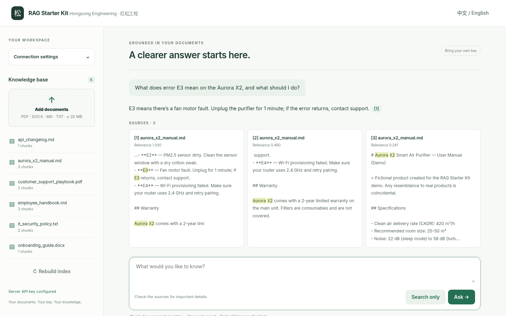
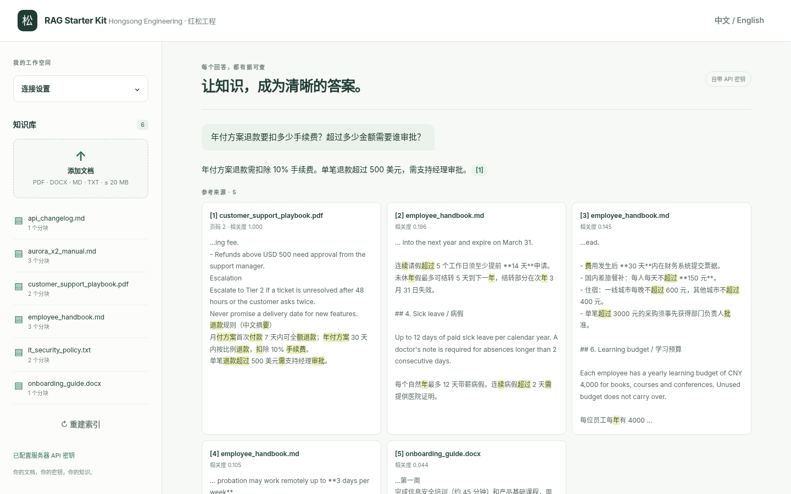
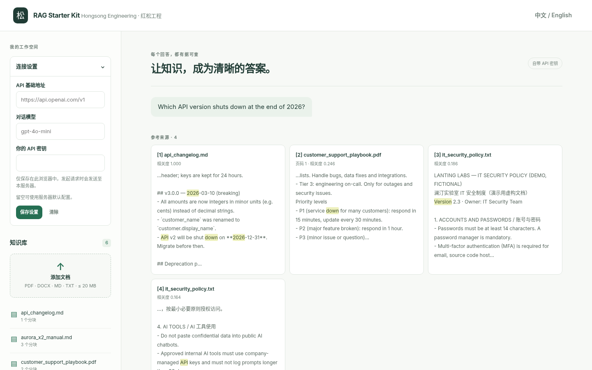

# RAG Starter Kit — Bring Your Own Key (Python + Docker)
*by Hongsong Engineering · 红松工程*

> This repository contains documentation and screenshots only. The source code is a paid download: https://hongsongeng.gumroad.com/l/nstdiz

A small, readable, self-hostable document Q&A app. Drop PDF, DOCX, Markdown and TXT files into a folder, ask a question, and get a streamed answer with clickable citations to the exact passages (PDF page numbers kept). About 1,000 lines of Python — no vector database, no CDN, no telemetry.

## Features
- Hybrid retrieval: BM25 (Latin words + Chinese bigrams) + optional vectors from any OpenAI-compatible /embeddings endpoint; falls back to keyword-only
- Streaming answers (SSE), sources first, clickable [n] citations
- Search-only mode with no API key
- English / 中文 UI · REST API · Dockerfile + compose
- Embeddings cached in local SQLite, scored with NumPy
- 90 offline tests (model calls mocked)

## Bring your own key
No API key, credits or model access is included or sold. Use any OpenAI-compatible endpoint (hosted, or vLLM / Ollama / LiteLLM). Your provider bills your usage.

## Requirements
Python 3.12+ or Docker with Compose. Tested on Linux only.

## Known limitations
- Vector search verified only against a mock OpenAI-compatible server
- No OCR (scanned PDFs yield no text)
- No login/auth; binds to 127.0.0.1 by default
- Full `docker compose up` on the default bridge network not run by us (image build + single container were)
- A few UI strings not yet translated to Chinese
- Starter kit, not a SaaS: no multi-tenancy, chat history or admin panel

## Licenses
Personal $29 · Commercial $59 (upgrade by paying the $30 difference). 14-day refund if it doesn't run as documented on a supported setup.

## Buy / licenses
- Product: https://hongsongeng.gumroad.com/l/nstdiz
- Personal $29 · Commercial $59
- 14-day refund if it does not install/run as documented on a supported setup
- Details: see [LICENSE-NOTICE.md](LICENSE-NOTICE.md)

## Maintainer
Hongsong Engineering / 红松工程 · hongsong-yu2010-nc52nt@mail.grokbot.com
